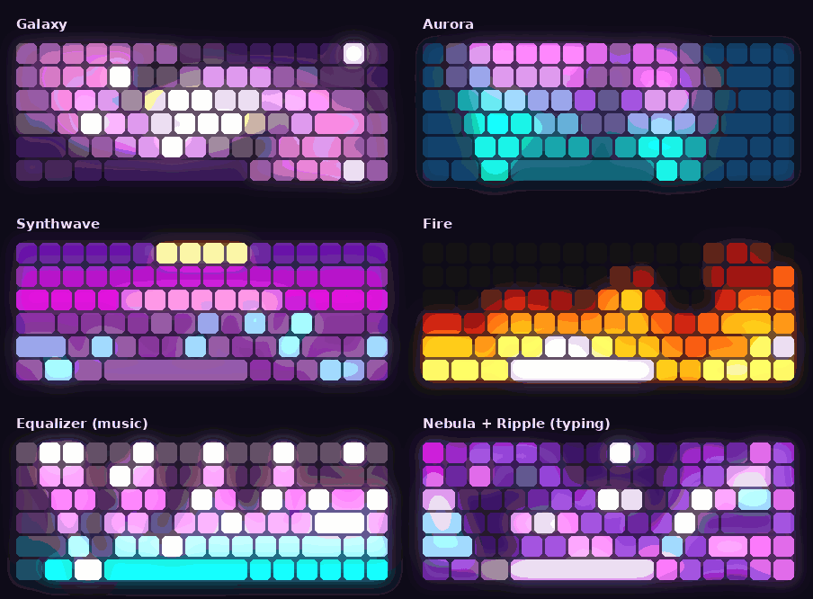
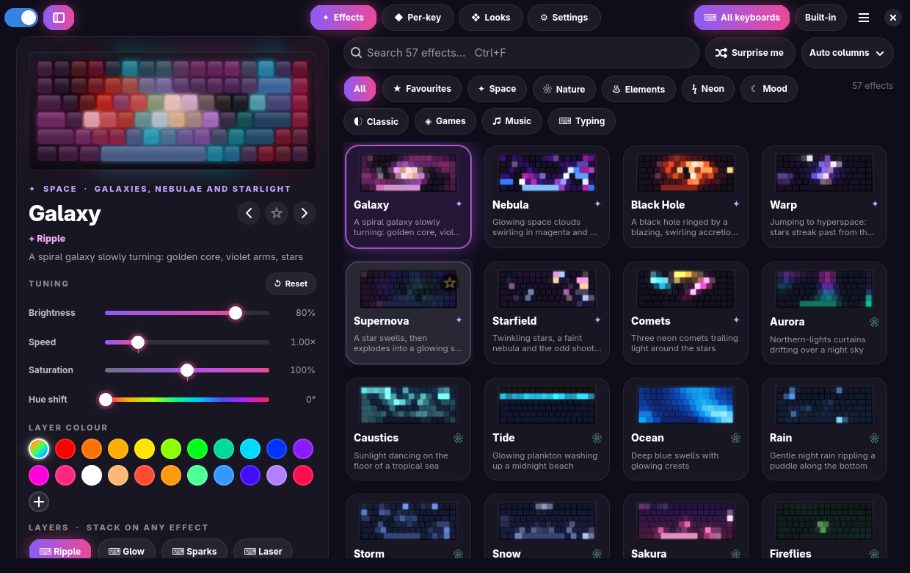
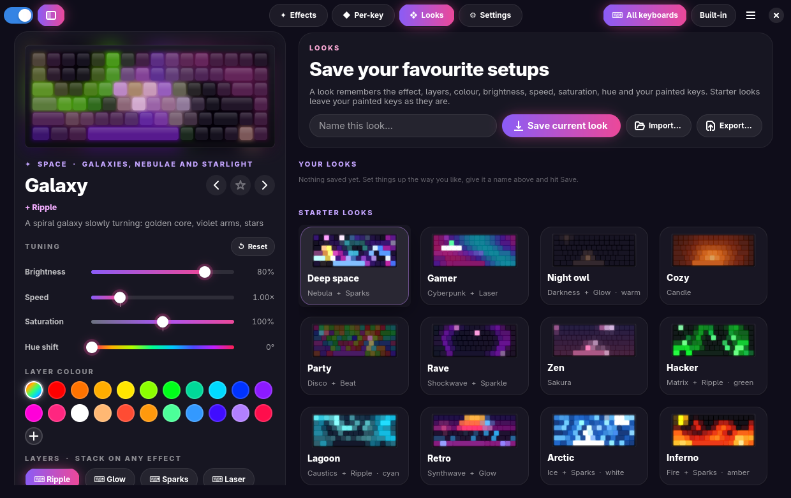

<div align="center">

# ✦ Lumikey

**Beautiful, animated, music‑ and typing‑reactive RGB for your keyboard, on Linux.**

Lumikey drives any keyboard that supports **Dynamic Lighting** (the open HID LampArray standard
Windows uses), so it works across brands without per-model drivers.



</div>

## Why Lumikey?

- **55 effects in 9 categories.** Space, nature, elements, neon, mood, classic, games, music and typing.
- **Reacts to your music.** Equalizer, VU meter, shockwaves and fireworks follow whatever is playing, through PipeWire or PulseAudio.
- **Reacts to your typing.** Add ripples, sparks, lasers and glow trails on top of any effect. Typing on your laptop's keyboard can light your external one too.
- **Per-key colours.** Paint WASD pink, the arrows cyan, or anything else. Painted keys stay on top of any effect.
- **Looks.** Save whole setups, switch between them in one click, and share them as files.
- **A polished control panel.** Live mirror of your keyboard, animated previews, search, favourites, auto-cycle and sleep when idle.
- **Scriptable.** Everything in the app is also a command: `lumikey galaxy`, `lumikey key wasd pink`, `lumikey cycle 5`.
- **Safe.** Colours live in the keyboard's memory only. Nothing is ever written to its firmware, and when Lumikey stops, the keyboard goes back to its own effects.
- **Light.** About 2% of one CPU core while animating.

<p align="center">
  
  
</p>

## Supported devices

Any keyboard (or other device) with **Dynamic Lighting / HID LampArray** support should work, since
Lumikey reads the layout, number of lights and colour depth from the device itself.
Many keyboards from 2023 onwards ship with it, from Lenovo, Logitech, Razer, ASUS, HP and others. If Windows
lists your keyboard under *Settings → Personalization → Dynamic Lighting*, it's very likely supported.

| Device | Status |
|---|---|
| Lenovo Legion K510 Mini Pro | ✅ Fully working, per-key (84 lights) |
| *Your keyboard?* | Run `lumikey devices` and [tell us](../../issues/new?template=new-device.yml)! |
| Lenovo Legion laptop keyboards (ITE 8258) | 🚧 Uses Lenovo's own protocol; planned |

**Not sure about yours?** Run `lumikey devices`. If it shows up, it'll most likely just work. Either way,
please [report it](../../issues/new?template=new-device.yml) so this table grows.

## Install

### Arch / CachyOS / Manjaro (AUR)

```sh
yay -S lumikey
```

### Any distro (pipx)

Install the system packages first (names vary slightly by distro):

```sh
# Fedora:  sudo dnf install python3-gobject gtk4 libadwaita pulseaudio-utils pipx
# Ubuntu:  sudo apt install python3-gi gir1.2-gtk-4.0 gir1.2-adw-1 pulseaudio-utils pipx
pipx install --system-site-packages git+https://github.com/abhinavverma0907/lumikey
```

### Then, once:

```sh
lumikey setup
```

This finds your keyboard and lets your user account light it. It asks for your password once to
install a small udev rule. It also starts Lumikey's background service. That's it:

```sh
lumikey-gui          # the control panel (find "Lumikey" in your app launcher too)
lumikey galaxy       # or straight from the terminal
```

Something not working? `lumikey doctor` checks every piece and tells you how to fix what's missing.

## Command line

```sh
lumikey list                      # every effect, layer, colour and key name
lumikey aurora                    # an effect
lumikey nebula+ripple+beat        # stack layers: typing ripples + music beat flashes
lumikey breathe pink              # effects that take a colour
lumikey ff8800                    # a solid colour (name or hex)
lumikey key wasd pink             # pin keys to a colour, over any effect
lumikey brightness 60             # also: speed, saturation, hue, flip, fade
lumikey random space              # surprise me (any category, or favorites)
lumikey cycle 5 favorites         # change effect every 5 minutes
lumikey idle 10                   # fade out after 10 minutes without typing
lumikey save "Night mode"         # looks: save / load / forget / looks
lumikey auto                      # hand the lights back to the keyboard
```

Bind them to keys in your desktop: for example, `lumikey next` on a media key, or `lumikey-gui` on Super+K.
Run `lumikey --help` for everything.

## How it works

```
lumikey-gui ──┐                                ┌─► /dev/hidraw*  (HID LampArray feature reports)
lumikey CLI ──┼─► ~/.config/lumikey/config.json ─► lumikey daemon (systemd user service, 30 fps)
              │                                └─◄ key presses (evdev) · music (parec + FFT)
```

The daemon parses the keyboard's HID report descriptor to find its LampArray reports, reads every
light's position and key, and then renders effects in physical millimetres. That's why the same
effect looks right on a 60% board, a full-size keyboard or a light strip.

## Contributing

Help is very welcome, especially **testing on keyboards we don't have**. See [CONTRIBUTING.md](CONTRIBUTING.md).
The most useful thing you can do: run `lumikey probe` and paste the output into a
[new device report](../../issues/new?template=new-device.yml).

## License

[GPL-3.0-or-later](LICENSE) © 2026 Abhinav Verma

Lumikey isn't affiliated with Lenovo, Microsoft or any keyboard maker. "Dynamic Lighting" is
Microsoft's name for the HID LampArray standard.
